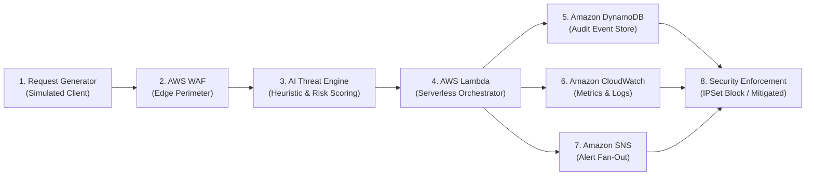

# CloudShield — How It Works

## 1. Overview & Purpose

**CloudShield** is an interactive, browser-based **Cloud Security Attack Simulator and Security Operations Center (SOC) Defense Dashboard**. 

Its primary purpose is to visually demonstrate how modern cloud-native security architectures detect, analyze, mitigate, and log cyber threats in real time. Rather than running dangerous live attacks on real infrastructure or incurring expensive cloud bills, CloudShield uses a **deterministic, safe, in-browser simulation engine** that mirrors the event-driven behavior of production AWS security services.

---

## 2. End-to-End Security Pipeline Flow

When an attack scenario is launched, the simulated HTTP request travels sequentially through an 8-stage cloud defense pipeline:

Every stage transitions through distinct visual states: **`waiting`** $\to$ **`processing`** (with progress animation) $\to$ **`completed`** (or **`threat/blocked`**).

---

## 3. Step-by-Step Breakdown: How Each Stage Operates

### Stage 1: Controlled Request Generator (Client Payload)
- **What it does:** Synthesizes an incoming HTTP request containing real-world attack vectors or benign web traffic.
- **Supported Scenarios:**
  1. **Normal Request** (Benign `GET /api/v1/products`) $\to$ Clean parameters, standard headers.
  2. **SQL Injection (SQLi)** (`POST /api/v1/auth/login`) $\to$ Malicious payload: `' OR '1'='1' --`.
  3. **Cross-Site Scripting (XSS)** (`POST /api/v1/comments`) $\to$ Script injection: ``.
  4. **Brute Force** (`POST /api/v1/auth/login`) $\to$ Rapid credential stuffing attempts (`admin/admin123`).
  5. **DDoS / Traffic Spike** (`GET /api/v1/checkout`) $\to$ High-frequency volumetric request flood exceeding rate limits.
  6. **Unauthorized Access** (`GET /admin/system-config`) $\to$ Privileged path traversal with missing or forged JWT bearer tokens.
  7. **Port Scan / Reconnaissance** (`SYN-PROBE /internal/management`) $\to$ Systematic scanning across restricted ports.
- **Controls:** Allows operators to customize the Source IP, HTTP target path, payload string, and simulation speed (**Fast**, **Normal**, **Demo Mode**).

---

### Stage 2: AWS WAF (Web Application Firewall Inspection)
- **AWS Equivalent:** `AWS WAFv2 WebACL` & `AWS Managed Rules (AMR)`.
- **Inspection Logic:**
  - Evaluates incoming request headers, query strings, body payloads, and source IP reputations.
  - Matches payloads against simulated WAF rule sets:
    - `AWS-AWSManagedRulesSQLiRuleSet`
    - `AWS-AWSManagedRulesKnownBadInputsRuleSet`
    - `AWS-RateBasedRule-100req`
    - `AWS-IPSet-Blacklist`
- **Output Decisions:**
  - `ALLOW` — Clean traffic passed through to application tier.
  - `BLOCK` — Malicious pattern detected; request dropped immediately at the edge.
  - `RATE_LIMIT` — Flood thresholds exceeded; client temporarily throttled.
  - `FLAG` — Suspicious reconnaissance marked for deep scrutiny.

---

### Stage 3: AI Threat Analysis & Heuristic Risk Engine
- **Role:** Evaluates the contextual threat landscape beyond static pattern matching.
- **Scoring & Heuristic Classification:**
  - **Risk Score (0–100 Scale):**
    - `0 – 24` : **LOW** (Benign / standard traffic)
    - `25 – 49` : **MEDIUM** (Minor anomaly / flagged probe)
    - `50 – 74` : **HIGH** (Dangerous exploit payload or unauthorized traversal)
    - `75 – 100` : **CRITICAL** (Severe database breach attempt, volumetric flood, or persistent attack)
  - **Confidence Metric:** Computes an assessment certainty percentage (e.g., `98% Confidence`).
  - **Explainable Reasoning:** Emits structured, contextual evidence bullets:
    - *Sensitive authentication endpoint targeted*
    - *Signature matches boolean-based SQL bypass*
    - *Cross-origin data exfiltration vector identified*
    - *Request volume exceeds 5x baseline capacity*
  - **Recommended Response:** Recommends tactical action (`BLOCK + ISOLATE`, `RATE_LIMIT`, `ALLOW`).

---

### Stage 4: AWS Lambda (Serverless Security Orchestrator)
- **AWS Equivalent:** `AWS Lambda Function (Python/Node.js Security Responder)`.
- **Orchestration Logic:**
  - Receives the WAF event and AI classification metadata.
  - Determines if active remediation is required.
  - If a **CRITICAL** or **HIGH** severity event is identified:
    - Initiates an edge block rule against the offending IP.
    - Asynchronously dispatches structured audit payloads to storage, monitoring, and alerting subsystems.
  - Generates simulated execution duration (e.g., `32 ms`) and invocation success status.

---

### Stage 5: Amazon DynamoDB (Security Event Store)
- **AWS Equivalent:** `Amazon DynamoDB (NoSQL Table: CloudShield_SecurityEvents)`.
- **Data Persistence:**
  - Automatically records the complete security lifecycle as a structured JSON document.
  - Stores:
    - `eventId` (Primary Key, e.g., `EVT-48102-SQLI`)
    - `timestamp` (UTC ISO format)
    - `sourceIp`, `attackType`, `targetEndpoint`, `method`
    - `wafRule`, `wafAction`
    - `aiSeverity`, `threatScore`, `aiReasoning`, `recommendedAction`
    - `lambdaStatus`, `finalAction`, `finalStatus`
  - All application pages (Logs, Analytics, Blocked IPs, Dashboard) read from this centralized event source.

---

### Stage 6: Amazon CloudWatch (Metrics & Observability)
- **AWS Equivalent:** `Amazon CloudWatch Metrics, Alarms & Log Groups`.
- **Telemetry Functions:**
  - **Metrics Namespace (`AWS/WAF`, `AWS/Lambda`, `AWS/DynamoDB`):**
    - Tracks live requests per minute, blocked requests, and allowed throughput.
    - Monitors consumed DynamoDB Write Capacity Units (WCU).
  - **Alarm System:** Evaluates thresholds (e.g., `HighVolumeFloodAlarm`) and switches from `OK` to `IN ALARM` when flood thresholds are crossed.
  - **Log Stream:** Streams real-time audit records into `/aws/cloudshield/security-audit`.

---

### Stage 7: Amazon SNS (Incident Alert Dispatcher)
- **AWS Equivalent:** `Amazon Simple Notification Service (Topic: cloudshield-soc-critical-alerts)`.
- **Fan-Out Behavior:**
  - Triggers for any threat classified as **HIGH** or **CRITICAL**.
  - Publishes actionable incident bulletins containing the offending IP, violation trigger, and mitigation action.
  - Feeds into the slide-out **SNS Security Alerts Drawer** with unread indicators and quick navigation links.

---

### Stage 8: Security Enforcement & Mitigation
- **Perimeter Isolation:** The offending IP is committed to the simulated **AWS WAF IPSet Blocklist**.
- **Global Synchronization:**
  - The live SOC Dashboard immediately increments the Blocked IP count and threat counters.
  - The Live SOC Activity Feed updates with the event disposition.
  - Future requests from the blocked IP are rejected at Stage 2 without proceeding further into the pipeline.

---

## 4. SOC Management & Analytics Pages

1. **Executive SOC Dashboard:** High-level overview of live security posture, metric counters, operational subsystem health, quick launch buttons, and live activity feed.
2. **Attack Simulator:** Interactive stage-by-stage pipeline visualizer, AI threat breakdown card, response summary card, timeline milestones, and live terminal console.
3. **Security Event Logs:** Full DynamoDB table explorer with multi-field filtering, JSON payload inspector, and one-click **CSV/JSON Export**.
4. **Threat Analytics:** Aggregated threat distributions, severity ratio meters, most targeted API endpoints, and top malicious IP addresses.
5. **AWS WAF Blocked IPs:** Management console for blocked IP sets, featuring IP inspection, simulated unblock capabilities, and custom manual IP blocking.
6. **System Monitoring:** Telemetry and operational diagnostics for all 6 cloud subsystems and live CloudWatch audit streams.

---

## 5. Tech Stack

| Category | Technology / Library | Purpose |
| :--- | :--- | :--- |
| **Core Framework** | **React 18** (`react`, `react-dom`) | Component-based interactive UI and reactive state architecture |
| **Language** | **TypeScript** (`~5.6.2`) | Strict type safety for security events, telemetry, and pipeline interfaces |
| **Build & Dev Tool** | **Vite 6** (`vite`, `@vitejs/plugin-react`) | High-performance build tool and instant HMR development server |
| **Styling & Design System** | **Tailwind CSS 3** (`tailwindcss`) | Dark SOC theme (Apple/Linear/Vercel palette: slate surfaces, selective violet accents) |
| **CSS Utilities** | `clsx`, `tailwind-merge` | Dynamic, conflict-free className resolution |
| **Iconography** | **Lucide React** (`lucide-react`) | Crisp, professional cybersecurity and cloud service icons |
| **State Management** | **React Context API** (`SecurityContext`) | Single source of truth for global metrics, event logs, blocked IPs, and notifications |

---

## 6. Architecture: Is It Only Frontend or Does It Have a Backend Also?

### Clear Answer:
**CloudShield is an entirely client-side, frontend-driven Single Page Application (SPA) with a built-in, local in-browser simulation backend.**

### Detailed Architectural Explanation:

1. **No External Backend Server Required:**
   - There is **no separate Python, Go, or Node.js/Express server** running on a secondary port.
   - There is **no connection to live AWS accounts**, AWS credentials, IAM roles, or remote databases.
   - Everything runs directly inside the browser using modern client-side JavaScript/TypeScript.

2. **In-Browser "Backend Simulation Engine":**
   - While there is no remote server, CloudShield is **not just static HTML/CSS mockups**.
   - It contains a **complete, programmatic backend simulation layer** located in `src/simulation/`:
     - `wafSimulator.ts` acts as the edge firewall rule evaluator.
     - `aiThreatEngine.ts` acts as the risk classification heuristics engine.
     - `lambdaSimulator.ts` acts as the serverless function runtime.
     - `dynamoDbSimulator.ts` acts as the in-memory database store.
     - `cloudWatchSimulator.ts` acts as the metrics and log streaming service.
     - `snsSimulator.ts` acts as the alert publisher.
     - `simulationEngine.ts` acts as the orchestrator controlling deterministic timing, stage transitions, and state mutations.

### Why This Architecture Was Chosen:
- **100% Safe & Legal:** Demonstrates complex cyber attacks and security mitigations without transmitting malicious packets across the internet or attacking real servers.
- **Zero Cloud Costs:** Completely free to run; no monthly AWS charges, DynamoDB provisioned capacity fees, or WAF request fees.
- **Instant Portability & Classroom Ready:** Can be launched on any laptop with just `npm run dev` and works offline without internet connectivity.
- **Zero Latency & Deterministic Reliability:** Perfect for presentations, viva examinations, and demonstrations, ensuring no network dropouts or API timeouts occur during presentation.
